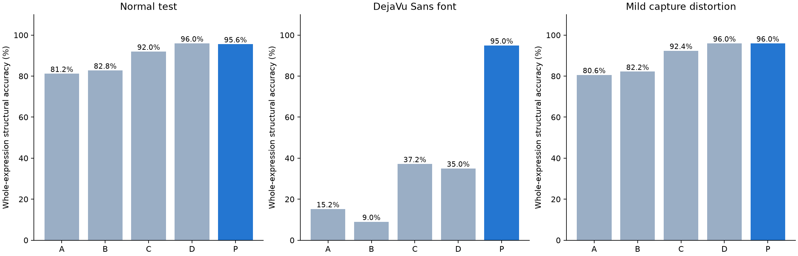

# 슬래시 표기: 실제 학습 비교 결과

CNN·LSTM encoder–decoder, attention·CTC 없음. **원본·폰트·왜곡 validation 평균 구조 정확도로 선택한 구성: P (P: practical slash LSTM).**

## 같은 시험 수식 500개

| 조건 | 입력 → 출력 | 모델 | 수식 전체 정확도 | 분수 100개 정확도 | 분모 정확도 | 1장 추론 중앙값 ms |
|---|---|---|---:|---:|---:|---:|
| A | stack → tex | seq2seq | 81.2% | 12.0% | 15.0% | 8.2 |
| B | stack → slash | seq2seq | 82.8% | 15.0% | 16.0% | 8.0 |
| C | slash → tex | seq2seq | 92.0% | 63.0% | 63.0% | 8.6 |
| D | slash → slash | seq2seq | 96.0% | 83.0% | 99.0% | 8.7 |
| P | slash → slash | seq2seq | 95.6% | 88.0% | 99.0% | 8.8 |

정확도는 출력 표기를 공통 수식 트리로 변환한 뒤 비교했다. 괄호·분자·분모·기호가 모두 일치해야 한다. 교환법칙이나 약분 같은 대수적 동등성은 사용하지 않는다.

## 활용 시 조건 변화

| 조건 | DejaVu Sans 폰트 | 약한 흐림·기울임·노이즈 | 별도 중첩 분수 |
|---|---:|---:|---:|
| A | 15.2% | 80.6% | 0.0% |
| B | 9.0% | 82.2% | 0.0% |
| C | 37.2% | 92.4% | 0.0% |
| D | 35.0% | 96.0% | 0.0% |
| P | 95.0% | 96.0% | 4.0% |

폰트: A–D는 STIX로 학습, DejaVu Sans로 평가. **P는 STIX·DejaVu Sans·Computer Modern을 학습하므로 해당 폰트는 P에게 미지의 폰트가 아니다.** capture: 같은 시험 수식에 ±1도 회전, 0.35px blur, 밝기 노이즈 sigma 4/255. 중첩 분수는 200개이며 A–D는 단층 분수만 학습했다. P는 별도 중첩 수식 1,000개도 학습했고 이 시험 수식과는 겹치지 않는다.

## 분석과 권장 구성

- **입력 이미지를 슬래시로 쓰는 것이 큰 차이를 보였다.** 출력만 바꾼 A→B는 1.6%p 변화였고, 입력을 바꾼 A→C는 10.8%p 개선됐다. 입력과 출력을 모두 슬래시로 맞춘 D의 분모 인식은 99.0%였다.
- **활용용 기본 모델은 P로 선택했다.** 같은 폰트의 기본 시험에서는 D가 P보다 2개 더 맞혔지만, DejaVu Sans 시험은 D 35.0%, P 95.0%였다. 여러 폰트가 들어올 수 있는 사용에서는 폰트 보강이 큰 도움이 됐다. 두 구성 모두 같은 CNN·LSTM 구조를 쓴다.
- **현재 사용 범위는 짧고 단순한 인쇄 수식이다.** P도 중첩 분수는 4.0%에 그쳤다. 임의의 긴 수식이나 손글씨에 바로 적용할 만큼 검증된 상태는 아니며, 손글씨 학습은 계획서의 후속 개발 범위다.

## 사용 가능한 결과물

- 선택 모델: `best_model.pt` (optimizer를 제외한 inference package).
- 한 장씩 평가한 시험 정확도: **95.6%**. 표의 기본 평가는 batch 32, 실제 한 장 입력도 별도로 확인했다.
- GPU 한 장 추론: 전처리된 CPU tensor에서 전송·모델·토큰 출력까지. 이미지 crop/resize와 파일 읽기 시간은 제외했다. warm-up 뒤 validation 이미지 60장으로 측정했다.
- `predict_best.py image.png`로 실행할 수 있다. 선택 모델이 기대하는 입력은 `slash`, 기본 출력은 `slash`다.

## 데이터와 학습

기존 통제된 데이터의 수식 목록과 분할을 그대로 재사용했다: train 3,000, validation 300, test 500, 중첩 200. 모델 간 같은 식을 읽는다. 같은 수식의 다른 렌더링은 train과 test에 분산하지 않았다. 출력 변환 4,000개의 수식 트리 동등성을 검사했다.

A는 동일 목록으로 이미 학습한 40 epoch checkpoint를 재사용했다. B/C/D는 같은 CNN–BiLSTM–LSTM, AdamW LR .001, batch 32, 40 epochs. 기호 어휘는 각 조건의 학습 정답에서 구성했다. CTC는 사용자 요청으로 제외했고 CTC 학습 모델은 사용하지 않았다.

P는 D에서 시작해 수식 4,000개(기존 3,000+새 중첩 1,000), 폰트 3종, 회전·흐림·노이즈 augmentation으로 24 epochs 추가 학습했다. 구조는 같은 CNN–BiLSTM–LSTM, cross-entropy이며 LR .0003에서 cosine 감소를 사용했다. P는 원본·폰트·capture validation 평균으로 checkpoint를 선택했다. 따라서 P의 변화는 출력 표기만의 효과가 아니다.

A–D checkpoint는 원본 validation 정확도로 선택했다. 최종 구성은 모든 모델의 원본·폰트·capture validation 구조 정확도의 평균으로 선택했다. 동률이면 원본 validation 정확도, 이후 추론 중앙값을 사용했다. test 결과로 checkpoint나 최종 구성을 선택하지 않았다. 기본 seed 42, 실사용 추가 학습 seed 44의 실행 결과다.

이 점수는 **제한된 5종 생성 문법의 인쇄 수식**에 대한 결과다. 임의의 논문 수식, 손글씨, 카메라 사진 전체 페이지의 정확도를 뜻하지 않는다. 기존 사진 속 상하 분수를 슬래시 입력으로 자동 변환하는 기능은 포함하지 않는다.

분수별 원본 이미지와 모든 모델의 예측은 [prediction_viewer.html](prediction_viewer.html)에서 볼 수 있다. 원시 지표는 `metrics.json`, 모든 예측은 `predictions_*.json`에 있다.
