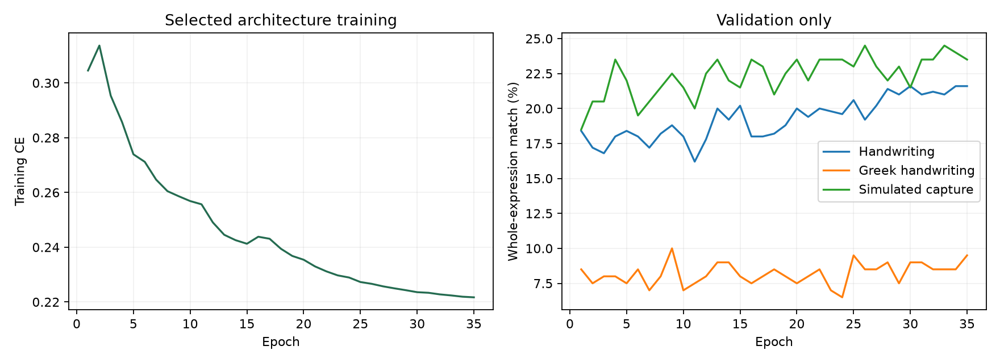

# 손글씨 물리 수식 OCR 고도화 결과

Attention과 CTC 없이 CNN–BiLSTM–LSTM을 유지하고, 그리스 문자·영문 대소문자·수치·분수·첨자·벡터를 포함하는 어휘와 실제 손글씨 학습을 추가했다.

## 같은 이미지에서 비교한 결과

수치는 **수식 구조 전체가 일치한 이미지 비율**이다. 기호별 정확도나 물리 법칙의 옳고 그름을 측정하는 값이 아니다. 손글씨 시험은 일반 수식의 부분집합으로, 손글씨 물리 법칙만 모은 시험은 아니다. 물리 공식 시험은 별도의 인쇄 이미지다. 괄호·곱과 분수의 일부 표기 차이를 정규화하되, 변수명·숫자·첨자·분모를 교정하거나 공식을 조회해 정답으로 바꾸지 않는다. 모든 최종 평가는 UI와 같은 전처리·batch size 1에서 정답 토큰 없이 수행했다.

| 평가 이미지 | 수 | 기존 P | 인쇄 전이 모델 | 새 손글씨 모델 |
|---|---:|---:|---:|---:|
|실제 손글씨|800|0.0%|0.0%|1.4%|
|그리스 문자 포함 손글씨|300|0.0%|0.0%|0.3%|
|손글씨의 모의 조명·회전 변화|800|0.0%|0.0%|1.1%|
|이전의 단순 인쇄 수식|500|95.6%|99.8%|96.8%|
|학습에서 제외한 인쇄 물리 공식|213|0.0%|11.3%|4.2%|

인쇄 전이 모델에서 손글씨 학습을 거친 최종 모델로 바꾸면 손글씨 전체 일치율은 +1.4%p, 그리스 문자가 포함된 식은 +0.3%p 변했다.

## 입력 길이에 따른 결과

토큰 수에는 `\frac`, 괄호·중괄호·첨자 기호도 포함된다. 단순 문자 수와 다르다.

| 토큰 수 | 시험 이미지 | 새 모델 구조 일치율 |
|---|---:|---:|
|1-8|49|10.2%|
|9-16|369|1.1%|
|17-24|281|0.4%|
|25-32|101|1.0%|

## 학습·선택 방식

- 학습 19,519개: human_handwriting 15,000, handwritten_symbol 2,119, printed_replay 2,400.
- 원본 MathWriting의 train/valid/test 구분을 유지했다. 검증 800개, 시험 800개이며 그중 그리스 문자 시험은 300개다.
- 학습과 평가 사이 InkML ID·이미지 해시 중복을 검사했다. 같은 수식을 다른 사람이 쓴 경우는 허용하므로 수식 문자열이 완전히 새로운 경우만 모은 시험은 아니다.
- 그리스 문자를 강조하고 1–32토큰·지원 어휘로 필터링한 부분집합이다. MathWriting 전체 benchmark 성적과 비교할 수 없다.
- 최종 시험은 학습·체크포인트·디코더 선택에 사용하지 않았다. 후보는 순차 전이 학습이며 학습 횟수와 손실도 달라서 구조 하나의 효과만 분리한 실험은 아니다.
- UI의 세 예제는 검증 데이터에서 인식된 짧은 식을 골랐다. 일반화 성능의 근거는 아래에 모두 공개한 독립 시험 800개다.
- 선택한 구조: `physics_handwriting_deep`, 체크포인트 epoch 35. 각 구조의 최고 학습 검증 체크포인트를 같은 검증 200개씩·batch size 1·UI 전처리에서 다시 비교했다.
- 검증으로 선택한 beam width 1, length alpha 0.
- CNN의 세로 위치 정보를 유지하고 BiLSTM의 최종 상태와 고정 8개 위치 특징을 결합했다. 손글씨 학습에는 기호 존재 여부와 출력 길이 보조 분류 손실을 추가했다.
- 고정 위치 보완 후보는 출력 단계·입력 너비·출력 길이로 정한 세 위치의 특징을 사용한다. 학습 중에는 실제 길이와 모델이 추정한 길이를 섞고, 추론에는 **모델이 추정한 길이만** 쓴다. Query/key·학습된 위치별 attention 가중치·CTC는 없다.
- 추가 CNN 후보는 128채널 residual block 2개와 압축하지 않은 고정 8개 위치 특징을 추가했다. 구조 선택 수치와 각 설정은 `candidate_selection.json`에 남겼다.
- 짧은 기호가 긴 식에 묻히지 않도록 보완 후보에서는 수식별로 평균한 cross-entropy를 사용했다.
- 회전 증강은 여백을 확장해 수식이 잘리지 않게 했고, 추론에는 종이 배경의 조명을 완화하는 연속 밝기 보정을 추가했다.

### 검증에서 비교한 후보

검증 점수는 손글씨 0.5 + 그리스 문자 포함 손글씨 0.25 + 모의 촬영 0.15 + 인쇄 0.1의 가중 평균이다. 아래 검증 수치는 각 부분집합 200개에서 UI와 같은 전처리로 다시 측정했다.

| 후보 | 파라미터 | 선택 epoch | Beam | 손글씨 | 그리스 포함 | 가중 검증 점수 |
|---|---:|---:|---:|---:|---:|---:|
|physics_handwriting_v1|5,703,475|14|3|20.5%|8.5%|19.5%|
|physics_handwriting_local|5,912,467|15|3|23.5%|7.5%|20.8%|
|physics_handwriting_deep|13,464,467|35|1|25.5%|9.5%|22.6%|

### 검증에서 비교한 디코더

문법이 유효하게 끝난 beam 후보 중 모델 점수가 가장 높은 출력을 고른다. 물리 공식 목록이나 정답으로 출력을 보정하지 않는다.

| Beam width | Length alpha | 가중 검증 점수 |
|---:|---:|---:|
|1|0|22.6%|
|3|0.6|22.5%|
|5|0.6|22.5%|

학습 중 그래프는 저장된 입력과 batch size 32의 검증 기록이다. 위의 최종 선택 표는 검증 표본 수와 전처리를 통일하고 batch size 1로 다시 측정한 값이다.

## 남은 오류와 실사용 범위

**손글씨 물리 수식의 실사용 목표를 달성하지 못했다.** 현재 모델은 실제 손글씨를 일반적으로 변환하기에 부족하다. 데이터 준비·학습·UI 기반과 측정 결과를 남긴 실험 모델로 보존한다.

- MathWriting은 디지털 펜으로 쓴 좌표를 여기서 이미지로 만든 데이터다. 실제 공책·화이트보드를 촬영한 사진의 정확도는 측정하지 않았다.
- 모의 촬영 시험은 원본 손글씨에 조명 그라데이션·작은 회전·잡음을 가한 데이터다. 실제 사진의 대체 benchmark가 아니다.
- 복잡한 중첩 분수, 긴 식, 행렬·다중 행, 매우 흘려 쓴 글씨는 지원을 보장하지 않는다.
- UI의 초록 상태나 문법 유효성은 수식이 정확하다는 뜻이 아니다.

- 새 모델 시험 token error rate: 52.2%.
- 빈 이미지 대조군 구조 일치율: 0.0%.

가장 많은 토큰 치환·누락·삽입(최소 편집 정렬 기준):

- `{` → `∅`: 239회
- `∅` → `{`: 158회
- `}` → `∅`: 144회
- `_` → `∅`: 112회
- `∅` → `}`: 108회
- `^` → `∅`: 107회
- `1` → `∅`: 88회
- `2` → `∅`: 84회
- `∅` → `_`: 84회
- `-` → `∅`: 67회
- `∅` → `^`: 55회
- `∅` → `2`: 52회

## 검증과 시험의 차이

시험 결과를 확인한 뒤 수행한 진단이다. 이 진단으로 모델·체크포인트·디코딩을 다시 선택하지 않았다.
- 내보낸 모델과 선택한 학습 체크포인트의 모든 가중치 일치: `True`.
- 내보낸 모델의 전체 검증 800개 구조 일치율: 20.5%.

| 부분 | 식 수 | 학습에 같은 구조의 식이 있는 수 | 평균 토큰 수 | 같은 식 구조 일치율 | 새로운 식 구조 일치율 |
|---|---:|---:|---:|---:|---:|
|검증|800|375|14.9|42.9%|0.7%|
|시험|800|27|16.8|11.1%|1.0%|

학습과 검증 사이에는 같은 식을 다른 손글씨로 쓴 경우가 많고, 시험에는 새로운 식과 더 긴 식이 많았다. 이미지·InkML ID 중복과는 다른 문제다. 현재 모델은 새로운 식의 기호·구조를 조합하는 일반화 성능이 부족하다. 식의 중복 여부·길이·필체의 영향을 이 실험 하나로 분리할 수는 없다.

- [내보내기 및 일반화 진단 원본](generalization_diagnosis.json)

## 주요 그리스 문자 포함 식

아래는 해당 문자가 들어 있는 **식 전체**의 구조 일치율이다. 개별 문자의 인식률이 아니며 식 길이와 복잡도의 차이도 포함한다. 여러 문자가 들어 있는 식은 여러 행에 포함된다. 표본이 적은 행은 해석에 주의해야 한다.

| 문자 | 손글씨 학습 정답에서의 출현 수 | 시험 식 수 | 식 전체 일치율 |
|---|---:|---:|---:|
|α (`\alpha`)|451|28|0.0%|
|β (`\beta`)|269|8|0.0%|
|γ (`\gamma`)|279|21|0.0%|
|δ (`\delta`)|219|13|0.0%|
|θ (`\theta`)|414|17|0.0%|
|λ (`\lambda`)|320|22|0.0%|
|μ (`\mu`)|491|31|0.0%|
|π (`\pi`)|774|55|0.0%|
|σ (`\sigma`)|378|23|0.0%|
|ω (`\omega`)|334|19|0.0%|

## 사용

`../start_ui.cmd`를 더블클릭한다. 기본 손글씨 모델과 기존 기본 모델을 UI에서 선택할 수 있다.

- [전체 손글씨 시험 800개 보기](handwriting_gallery.html)
- [원본 수치](handwriting_metrics.json)
- [검증 기반 구조 선택](candidate_selection.json)
- [검증 기반 디코더 선택](decoder_selection.json)

데이터: [Google Research MathWriting](https://github.com/google-research/google-research/tree/master/mathwriting), CC-BY-NC-SA-4.0. 원본 다운로드 SHA-256 및 GCS MD5 검증은 `../data_mathwriting/raw/`의 JSON에 기록했다. 인쇄 전이 학습에는 [IM2LATEX 배포본](https://huggingface.co/datasets/yuntian-deng/im2latex-100k) 일부와 Matplotlib 합성 수식을 사용했다.
