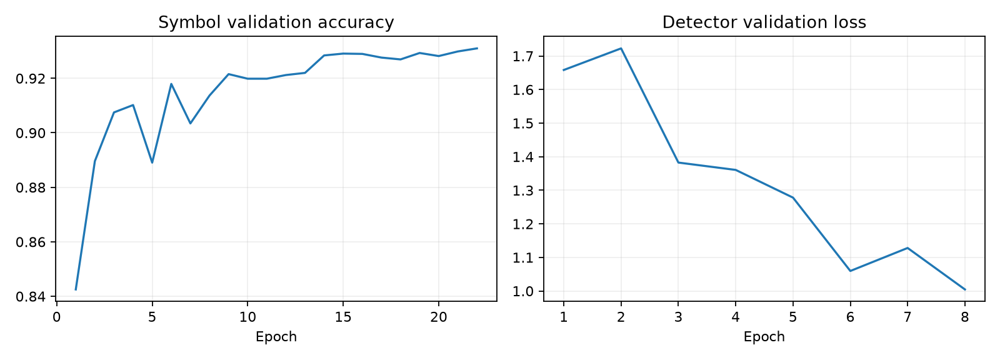

# 기호 분할 → CNN 분류 → 공간 관계 조합 실험

자동 파이프라인의 수식 전체 구조 일치율은 **25.3%**다. 같은 시험 이미지에서 이전 CNN–LSTM은 **5.2%**였다.

## 같은 입력에서 단계별 비교

| 조건 | 수식 전체 일치율 | 학습에 없던 식의 일치율 |
|---|---:|---:|
|이전 CNN–LSTM|5.2%|4.5%|
|정답 기호 위치·이름 제공 → 관계 모델·파서|70.1%|68.7%|
|정답 기호 위치 제공 → CNN 분류·관계·파서|39.0%|37.0%|
|자동 연결요소 분할 → CNN·관계·파서|25.3%|24.0%|
|자동 CNN 검출 → CNN·관계·파서|13.5%|12.5%|

기호별 정답 영역에서 CNN의 시험 정확도는 88.1%, 상위 3개 후보 포함률은 98.0%다. 이 수치를 수식 전체 정확도로 해석하면 안 된다.

**정답 위치/이름 제공 행은 진단용 조건이다. 실제 입력에서의 성능은 자동 분할·검출 행을 봐야 한다.** 검증에서 선택한 자동 방식은 `components`다.

## 데이터와 선택

- CROHME 2013의 기호·MathML 정답이 있는 부분집합: 학습 6,197식 / 검증 1,020식 / 공식 시험 482식.
- 기호 예시: 학습 54,412개 / 검증 8,896개 / 시험 4,100개. 실제 출현 기호는 87종이다.
- 지원 어휘·MathML 구조로 필터링했다. 전체 CROHME benchmark 성적과 직접 비교할 수 없다.
- 원래 학습 파티션을 수식 내용 단위로 나눴다. 학습과 검증의 수식 내용 중복은 0이며, 다른 필체로 같은 식을 쓴 사례도 같은 쪽에 둔다.
- 원래 시험 파티션은 유지했다. 시험 41식은 학습에 같은 내용이 있고, 나머지는 새로운 식이다. 이미지·정규화 획 해시의 교차 중복은 제거·검사했다.
- 기호 CNN은 검증 기호 정확도, 관계 MLP는 검증 관계 macro F1, 검출 CNN은 검증 검출 손실로 체크포인트를 선택했다.
- 최종 검출·관계 임곗값은 수식별 최대 3개 이미지로 구성한 검증 표본에서 선택했다. 시험 성적을 보고 모델이나 임곗값을 다시 선택하지 않았다.
- 최종 자동 평가와 CLI/UI는 같은 이미지 전처리를 사용한다. 정답 영역 제공 조건에서는 전처리의 좌표 변환을 정답 영역에도 적용했다.
- UI 예제는 검증에서 고른 샘플이다. 아래 갤러리는 시험 사례 전부를 포함한다.

## 구현

- 기호 분류: 약 45만 파라미터 CNN → 128차원 특징 → 기호 클래스. 정답 획만 남긴 이미지와 주변 획이 포함된 bbox crop을 섞어 학습했다.
- 공간 관계: 두 기호의 CNN 특징 256차원 + 상대 위치·크기·겹침 16차원 → Dense 128 → Dense 64 → 7관계.
- 자동 검출: CNN 중심 heatmap + 너비·높이 + 위치 보정. 긴 분수선과 근호를 위해 축소된 특징의 넓은 문맥 CNN을 추가했다. 국소 검출기 파일럿에서 전이 학습했다.
- 조합: 분수·근호 영역의 재귀 처리와 Right/Sup/Sub 그래프 구성으로 LaTeX를 생성한다. 초기 버전은 기호 top-1을 조합하고, top-3 수치는 향후 후보 탐색의 여지를 진단하는 용도다.
- Attention, Transformer, CTC, 전체 공식 조회·암기는 사용하지 않는다. 일반 인식 경로는 이미지 외의 획 순서·정답 bbox·정답 기호·정답 구조를 받지 않는다.

## 분할 품질

| 자동 방식 | Box precision (IoU≥0.5) | Box recall (IoU≥0.5) |
|---|---:|---:|
|components|88.2%|95.3%|
|detector|81.7%|89.2%|

## 활용 범위

**확인 없이 사용하는 손글씨 OCR 수준에는 아직 부족하다.** 자동 분할·기호 혼동·공간 관계 오류가 누적된다. UI에서 분할 영역과 LaTeX 결과를 원본과 대조하는 실험 모델로 제공한다.

- 디지털 펜 좌표를 여기서 이미지로 만든 시험이다. 실제 공책·화이트보드 사진 성능은 측정하지 않았다.
- CROHME 기반 성적을 이전 MathWriting 800개 시험 성적과 직접 비교하면 안 된다. 위 표는 새 시험 입력에 이전 모델도 다시 실행한 비교다.
- 이전 모델은 MathWriting 중심, 새 모델은 CROHME 중심으로 학습했다. 학습 데이터도 달라서 이 표만으로 모델 구조 하나의 효과를 분리할 수는 없다.
- 긴 식, 붙어 쓴 기호, 복잡한 중첩, 행렬·다중 행과 학습에 없는 기호는 추가 검증이 필요하다.

## 실행

기존 `../start_ui.cmd`를 실행하고 **기호 분할 · CNN (실험)**을 선택한다. 인식 후 **기호 분할 결과**에서 검출 영역을 확인할 수 있다.

```powershell
../.venv/Scripts/python.exe predict.py my_formula.png --overlay segments.png
```

- [전체 시험 결과](gallery.html)
- [시험 수치](test_metrics.json)
- [검증 기반 설정 선택](models/validation_selection.json)
- [독립 데이터 검사](data/audit.json)

## 데이터 출처

CROHME 공식 서버가 응답하지 않아 [CROHME_extractor 공개 배포본](https://github.com/ThomasLech/CROHME_extractor)을 고정 commit으로 내려받았다. 다운로드 URL·SHA-256은 `raw/provenance.json`에 기록했다. 원본 데이터는 [CROHME 공식 설명](https://www.isical.ac.in/~crohme/CROHME_data.html)의 비상업적 학술 이용 조건을 따른다. 이 구현은 DPRL 코드를 복사하지 않고 CNN·MLP와 파서를 작성했다.

## 다른 데이터로의 전이 진단

이전에 사용했던 MathWriting 시험 800개의 같은 저장 이미지에 적용하면, 기존 모델 1.4%, 새 조합 모델 7.0%였다. 그리스 문자 포함 300식에서 새 모델은 3.0%였다.
이미 사용했던 시험의 추가 진단이며 새 독립 시험으로 주장하지 않는다. 이 결과로 모델·임곗값을 바꾸지 않았다. 입력은 이전 실험의 64px 이미지로, 원래 고해상도 필기나 공책 사진은 아니다.

[전이 진단 수치](transfer_metrics.json)


